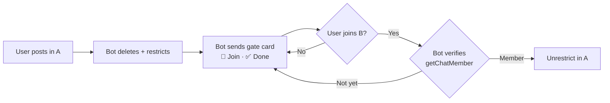

<div align="center">


# Portcullis

**A Telegram gate bot. Members of Group A must join Group B before they can speak in A.**

[](https://www.python.org/)
[](https://python-telegram-bot.org/)
[](./LICENSE)
[](https://github.com/)

</div>

---

## 🧭 What it does

A member posts in **Group A** → their message is deleted, they're restricted, and the bot drops a gate card with a **Join** button and a **Done** button. After joining **Group B** (public, private, or request-to-join), they tap **Done**, membership is verified live, and they're unrestricted in A.

No join → no voice.

---

## 🗺️ Flow



---

## ✨ Features

- 🔒 **Auto-gate** — any message from a non-member in A is deleted and replaced with the gate card
- 🔗 **Any group type** — private with approval, public with request-to-join, plain public
- ✅ **Done button** — one tap after joining, bot re-verifies live
- 🧠 **Cache** — one `getChatMember` per user, not per message
- ♻️ **Leave detection** — user leaves B, cache drops, next message in A re-gates them
- 🛠️ **Per-chat toggle** — `/gate` and `/ungate` from chat admins
- 🪶 **Zero database** — in-memory, single file, no infra beyond a host

---

## 🚀 Quick start

```bash
git clone https://github.com/realximanta/portcullis-bot.git
cd portcullis-bot
pip install -r requirements.txt
BOT_TOKEN=xxx TARGET_CHAT_ID=-1001234567890 GATED_CHAT_IDS=-1009876543210 python bot.py
```

---

## 🔑 Environment

| Variable | Required | Description |
|---|---|---|
| `BOT_TOKEN` | ✅ | Bot token from [@BotFather](https://t.me/BotFather) |
| `TARGET_CHAT_ID` | ✅ | Group/channel **B** id (prefixed `-100`) — the membership source of truth |
| `GATED_CHAT_IDS` | ✅ | Comma-separated group **A** ids where the gate applies |

---

## 🛡️ Required permissions

**In Group A** — bot must be admin with:
- 🗑️ `can_delete_messages`
- 🔨 `can_restrict_members`

**In Group B** — bot must be admin with:
- 🔗 `can_invite_users`

Missing any of these = silent failure. Check here first.

---

## 🎮 Commands

| Command | Where | Who |
|---|---|---|
| `/start` | DM | Anyone — check your gate status |
| `/gate` | Group A | Admins — enable gating here |
| `/ungate` | Group A | Admins — disable gating here |

---

## ☁️ Deploy

| Platform | Best for | Link |
|---|---|---|
| 🧪 **GitHub Codespaces** | Build & test, ephemeral | [codespaces.new](https://codespaces.new) |
| 🌐 **Koyeb** | 24/7 free tier, auto-deploy from repo | [koyeb.com](https://www.koyeb.com/) |
| 🚂 **Railway** | 24/7, $5 starter credit | [railway.app](https://railway.app/) |

Set the three env vars in the host's dashboard, point it at the repo, done.

---

## 🧱 Architecture

```
bot.py
├── is_member()          — live getChatMember + cache
├── get_invite()         — create_chat_invite_link, prefers request-mode
├── send_gate()          — delete + restrict + gate card
├── on_new_members()     — restrict + gate on join
├── on_message()         — delete + restrict + gate on post
├── on_done()            — verify + unrestrict across GATED
└── on_my_chat_member()  — cache invalidation on leave
```

Single file, ~200 LOC. Split only when it crosses 400.

---

## ⚠️ Known limits

- 💾 `VERIFIED` cache is in-memory — restart clears it, users re-tap **Done** once
- 🔢 No rate-limit backoff yet — Telegram will throttle at volume
- 🗄️ No persistent per-user stats — SQLite is the next layer

---

## 🤝 Contributing

PRs are welcome. Open an issue first for anything beyond a typo or a one-liner.

---

<div align="center">

**[⬆ back to top](#portcullis)**

</div>
